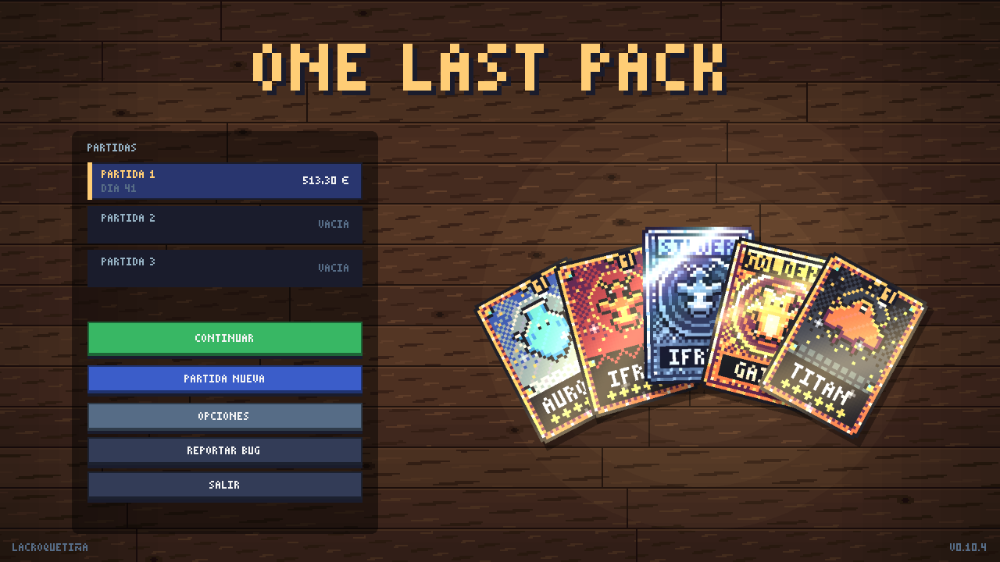
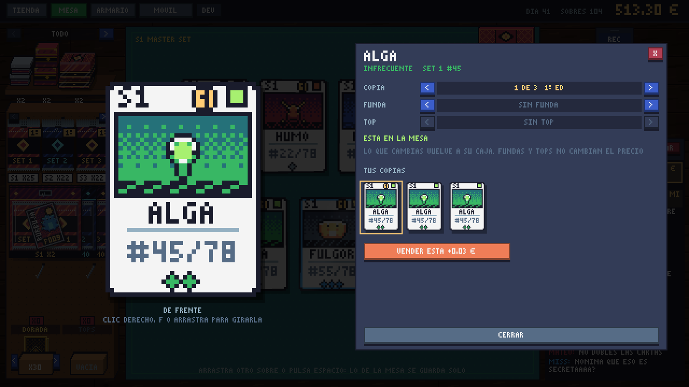
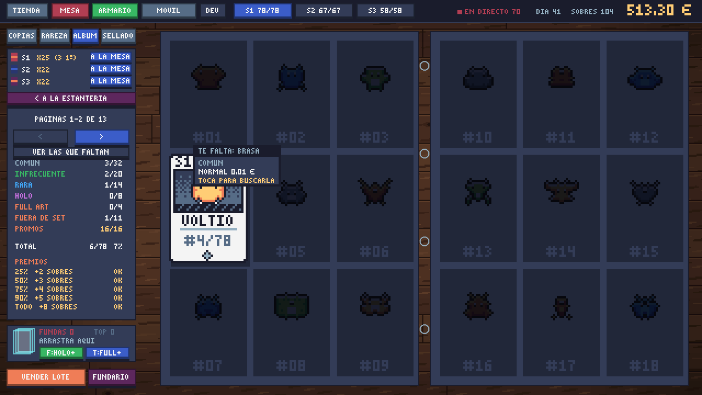
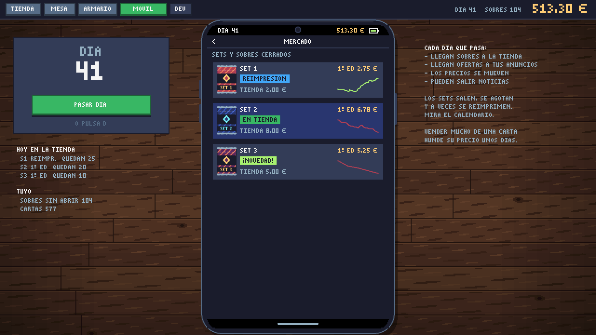

# One Last Pack


Simulador de abrir sobres de un TCG propio. Estás en tu cuarto con una mesa, un móvil y un trípode: compras sobres, cajas y ETB, los abres en directo con un chat que reacciona a todo lo que te sale, completas la colección y vendes en un mercado que sube y se hunde.

Lo hago en Lua con LÖVE, a 640x360 en pixel art. Funciona en PC y en Android. El objetivo es sacar una demo en Steam.


## Índice

- [Qué hay](#qué-hay)
- [Capturas](#capturas)
- [Cómo jugarlo](#cómo-jugarlo)
- [Controles](#controles)
- [Twitch](#twitch)
- [Cómo está organizado](#cómo-está-organizado)
- [Pruebas y economía](#pruebas-y-economía)
- [Versiones](#versiones)

## Qué hay

**Las cartas**
- 8 sets, cada uno con su elemento, su precio de sobre (de 2 a 15 €) y de 50 a 80 cartas. Un set nuevo cada 18 días.
- Seis rarezas, chase, god pack y piedad. Las cartas se generan por código: un bicho, su fondo y su acabado según la rareza.
- Cartas de fuera de set (secretas, ALT, SILVER y GOLDEN): no cuentan para el 100% del set, pero sí para el MASTER SET.
- Cada set sale en 1ª edición, se agota, pasa a reventa y luego llegan las reimpresiones.

**Abrir**
- Mantener para rasgar y revelar de peor a mejor, con suspense en las buenas y velocidad de apertura como mejora.
- Productos sellados: sobres, blíster de 2, tin, ETB y caja de 36. Cada uno se abre con su animación y trae su promo. La caja se queda abierta como expositor, con los sobres de cara en tres columnas.
- Mesa con física de péndulo al arrastrar sobres, cajas, fundas y cartas.
- Fundas y top loaders básicos y con diseño (43 fundas y 17 tops), que se ponen a mano o solos.
- INSPECCIONAR: cualquier carta en grande, que se gira, con sus copias, su funda y su top.

**El directo**
- Espectadores, seguidores, propinas y peticiones del chat, en español o en inglés y con su jerga.
- Directos de venta de sobres: el chat te compra y tú decides a quién no venderle.
- Conexión con el chat de tu canal de Twitch (ver [Twitch](#twitch)).

**El mercado y el móvil**
- Precios que se mueven por días, con memoria: rachas, noticias, burbujas, crashes, vintage de la 1ª edición, tirada limitada y torneo nacional.
- Cada producto sellado tiene su propio precio y su gráfica.
- El móvil del juego con sus apps: cartera, mercado (con vendedores de segunda mano y colabs), ventas, noticias, calendario, encargos, mejoras y logros.

**La colección**
- Álbum por set (1ª edición y reimpresiones), con FUERA DE SET, MASTER SET y PROMOS.
- Carpetas propias: pones la copia que quieras en el bolsillo que quieras.
- Armario de sellado de 3x4 huecos que se ordena arrastrando.
- Promos de cada set, colabs con marcas de broma y placas del canal.
- Premios por completar sets, cartas buscadas, desbloqueos por hitos y un tutorial con una mascota (se puede quitar).
- 3 partidas a la vez.

## Capturas

| | |
|---|---|
|  |  |
|  |  |
|  |  |
|  |  |

## Cómo jugarlo

Las APK y los zip de Windows de cada versión están en [Releases](../../releases). El zip se descomprime y se abre `OneLastPack.exe`; la APK se instala en el móvil (siempre en horizontal). También va el `.love`, que se abre con LÖVE 11.5.

Desde el código:

1. Instala [LÖVE 11.5](https://love2d.org).
2. Arrastra la carpeta del proyecto encima de `love.exe`, o en terminal: `love one-last-pack`.

Hay 3 partidas (PARTIDA 1, 2 y 3 en el inicio) y se guardan solas en `partida.lua`, `partida2.lua` y `partida3.lua`. En Windows están en `%APPDATA%/LOVE/one-last-pack/` si lo abres desde el código y en `%APPDATA%/one-last-pack/` con el zip. Las opciones (volumen, Twitch, tutorial) van en `opciones.txt`, en la misma carpeta.

## Controles

En PC se juega con ratón; en Android, igual pero tocando.

**General**
- TAB: cambiar entre tienda, mesa, armario y móvil.
- D: pasar el día. Rueda o arrastrar: scroll en el móvil. Retroceso: atrás en el móvil.
- F11 o Alt+Enter: pantalla completa (también en OPCIONES). ESC: volver al inicio.
- OPCIONES: volumen, Twitch, TUTORIAL SÍ/NO (sin tutorial no hay explicaciones y lo nuevo llega como aviso pequeño) y VER TUTORIAL.
- Inicio: las cartas de la derecha (tus mejores) se cogen, se arrastran y se giran al tocarlas.
- F1: herramientas de desarrollador.

**Mesa**
- Arrastra un sobre del gancho al tapete y mantén pulsado para rasgarlo. Clic o espacio revela la siguiente carta.
- Espacio: recoger y abrir el siguiente sobre.
- Guardar un sobre sin abrir: botón GUARDAR, arrastrarlo a la caja, ESC o clic derecho.
- Blíster, tin, ETB y caja: se arrastran al tapete para abrirlos. Tocando uno cerrado sale SACAR SOBRES. Sus sobres quedan en la esquina; las fundas, los tops y la promo se quedan sueltos en la mesa. RECOGER MESA lo guarda todo.
- Sobrecitos promo, de torneo y el correo: cuelgan de los ganchos y se arrastran al tapete como un sobre. El de la ETB o la caja recién abierta se queda en la mesa: al tapete se abre, a tu caja se guarda cerrado.
- Fundas y tops: se arrastran de la caja a una carta cuando el sobre ya está abierto. Un top sin funda también se puede poner, pero la carta se puede rayar.
- Fundas y tops con diseño: en sus cajitas de la mesa; < > cambia el de arriba y tocando el nombre se ven todos. Se arrastran a una carta, o se suelta la carta encima de la cajita.
- Velocidad de apertura: con la mejora MANOS RÁPIDAS, el botón >> de arriba a la izquierda del tapete la cambia (también en plena apertura).

**INSPECCIONAR**
- Toca una carta de la mesa, la grande del armario o una del álbum o de una carpeta.
- Se gira con clic derecho, F, doble toque o arrastrando a los lados; ← → cambian de copia.

**Armario**
- SELLADO: arrastra lo de un hueco a otro para colocarlo a tu manera (si el otro está lleno, se cambian). ORDENAR lo coloca por set o por tipo.
- Carpetas: en ÁLBUM, el hueco NUEVA CARPETA de la estantería. Se arrastra una carta de abajo a un bolsillo (entra la mejor copia libre), de un bolsillo a otro o fuera para sacarla. Tocando un bolsillo sale INSPECCIONAR para cambiar la copia.

**Directo**
- En la mesa, ponle nombre al canal y dale a EMPEZAR DIRECTO. La tienda y el armario no lo cortan; ir al móvil o pasar el día, sí.

## Twitch

En OPCIONES (o CONECTAR TWITCH en el directo) escribe tu canal y dale a CONECTAR. Solo lee el chat, sin iniciar sesión, y se reconecta solo. Dos modos: MEZCLADO (tu chat junto al del juego) o SOLO TWITCH.

Los mensajes, los emotes de tu canal, los subs, los regalos y los raids salen en el chat del juego. Lo que pasa en tu chat no da dinero, salvo `!comprar` en la venta de sobres.

| Comando | Qué hace |
|---|---|
| `!comprar 3` | En la venta de sobres, pide 3 sobres. `!comprar etb` pide una ETB y `!comprar bl` un blíster. Como mucho 3 compras del chat a la vez entre todos y una por persona, y solo desde los 50 seguidores. |
| `!soplar` | Cuanta más gente sopla, más tiembla el sobre antes de abrirlo. |
| `!pausa` / `!seguir` | Solo tú y tus mods: paran y vuelven a poner las ventas. |

El botón COMANDOS, junto a TWITCH, enseña esta tarjeta en el directo (también sale unos segundos al empezar).

## Cómo está organizado

```
main.lua        escenas, entradas, barra de arriba y riel lateral
conf.lua        ventana y versión de LÖVE
datos/          tablas sin lógica: cartas, sets, sobres, mercado, mejoras, chat...
src/            lógica y pantallas
sprites/        logo y mascota
musica/         tema de la intro
herramientas/   pruebas automáticas, bots de economía, simulador de mercado y APK
docs/img/       capturas de este README
```

Casi todo lo que se ajusta está en `datos/`, separado del código:

- `datos/cartas.lua`: todas las cartas, una línea por carta. Las de fuera de set (ALT, SILVER y GOLDEN) salen solas de las marcadas.
- `datos/rarezas.lua`: suspense, brillo y acabado de cada rareza.
- `datos/variantes.lua`: las cartas de fuera de set: nombre, color, brillo y suspense.
- `datos/sets.lua`: los sets y lo que vale cada rareza en cada uno.
- `datos/sobres.lua`: precio, huecos y probabilidades de cada sobre, god pack, piedad, cajas y con qué se empieza.
- `datos/productos.lua`: los productos sellados (blíster, tin, ETB, caja): qué llevan, precio, cuántos llegan al día y cuántos caben en un hueco.
- `datos/fundas.lua`: las fundas y los tops con diseño: nombre, color, de dónde sale cada uno, packs y premios.
- `datos/promos.lua`: las promos de cada set (de dónde salen, estilo, valor y cuánto salen), las colabs, los sobres de torneo, la preventa y las placas del canal.
- `datos/calendario.lua`: cada cuánto sale un set, cuánto dura su tirada y sus reimpresiones.
- `datos/mercado.lua`: cómo se mueven los precios (rachas, noticias, vintage, burbujas, comisión, compradores).
- `datos/directo.lua` y `datos/chat.lua`: espectadores, propinas, venta en directo, comandos de Twitch y las frases del chat.
- `datos/mejoras.lua`, `datos/encargos.lua`, `datos/vendedores.lua`, `datos/logros.lua`, `datos/premios.lua`.
- `datos/desbloqueos.lua` y `datos/guia.lua`: qué se desbloquea y cuándo, y los textos de la mascota.
- `datos/paleta.lua` (Sweetie 16), `datos/elementos.lua` y `datos/firma.lua`.

En `src/`:

- `mesa.lua`, `apertura.lua`, `sobre.lua`, `caja.lua`, `productos.lua` y `encima.lua`: la mesa, abrir sobres, el dibujo de los sobres, la caja expositor, el dibujo de los demás productos sellados y lo que se pinta a resolución real (lo que se arrastra).
- `muebles.lua` y `escritorio.lua`: estanterías, baldas, ganchos, blísters y álbumes en 3D, con la misma perspectiva que la caja, y la mesa de madera del fondo.
- `directo.lua` y `emojis.lua`: el directo, su chat, los comandos y los emojis.
- `twitch.lua`: el chat de Twitch por IRC (solo lectura, en un hilo aparte).
- `movil.lua`, `grafica.lua` y `vendedores.lua`: el móvil con todas sus apps.
- `tienda.lua`, `armario.lua`, `menu.lua`, `opciones.lua`, `reporte.lua` y `errores.lua`: el resto de pantallas.
- `mercado.lua` y `calendario.lua`: el mercado y las fechas de cada set.
- `carta.lua`, `bicho.lua` y `generador.lua`: cómo se pinta una carta, el generador de bichos y el sorteo de cada sobre.
- `fundas.lua`, `fundario.lua` e `inspeccionar.lua`: el dibujo de las fundas con diseño, su rejilla (cajitas de la mesa y FUNDARIO) y la carta en grande que se gira.
- `carpeta.lua`: las carpetas propias (en la estantería de álbumes).
- `promo.lua`: el dibujo de las promos, las colabs, las placas del canal y los sobrecitos.
- `partida.lua`: el guardado, copia a copia, y las 3 partidas.
- `desbloqueos.lua`, `guia.lua`, `tutorial.lua` y `logros.lua`: el progreso.
- `ui.lua`, `fuentes.lua` (fuente propia de 3x5), `fx.lua`, `sonido.lua`, `nav.lua`, `transicion.lua` y `dev.lua`.

Si una carta lleva `sprite = "algo.png"` en `datos/cartas.lua`, se usa ese dibujo de `sprites/` en vez del bicho generado. Si existe `sprites/escritorio.png`, sustituye a la mesa de madera.

## Pruebas y economía

En `herramientas/` hay:

- Un arnés que juega solo con el juego en una pantalla virtual, pulsa botones, comprueba la lógica y saca capturas (también como un móvil alargado).
- Bots que juegan 240 días con distintas estrategias para ver si la economía aguanta.
- Un simulador del mercado de 600 días que saca los precios en CSV.
- Un lector de los reportes de bugs que guarda el juego, y el script que hace la APK.

Cómo se usan, en [herramientas/LEEME.md](herramientas/LEEME.md). En cada push, GitHub pasa `luacheck` al código.

## Versiones

Lo que cambia en cada versión está en [CHANGELOG.md](CHANGELOG.md). Cada versión tiene su etiqueta (`v0.10.4`) y su build en Releases. El juego se queda por debajo de 1.0 hasta que esté completo.

## Licencia

Todos los derechos reservados. Es un juego comercial y el repo es solo para consulta.
