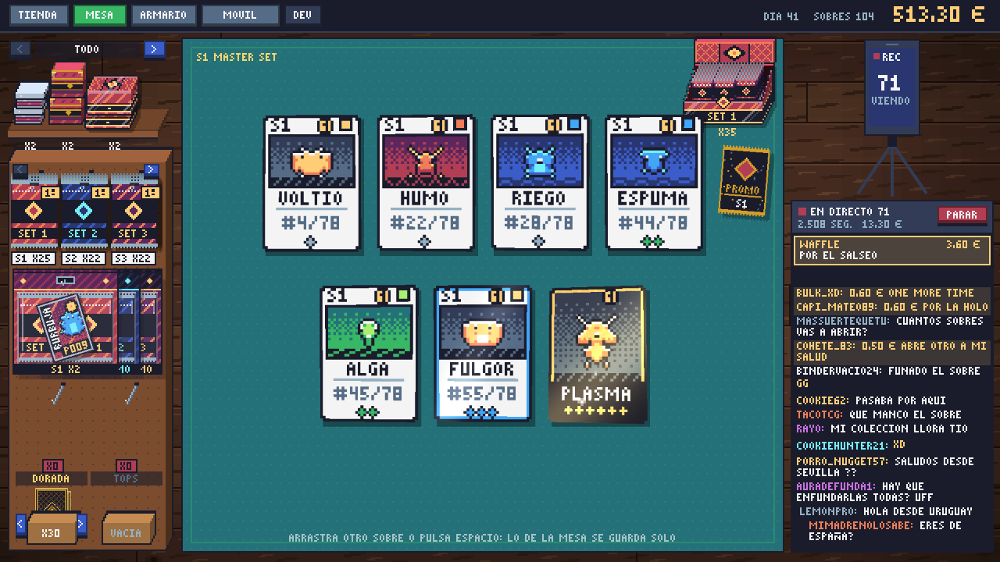
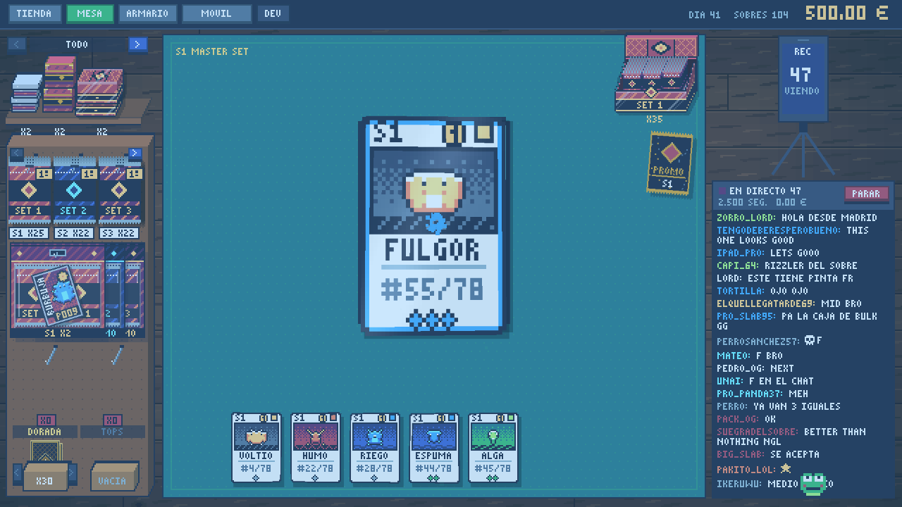
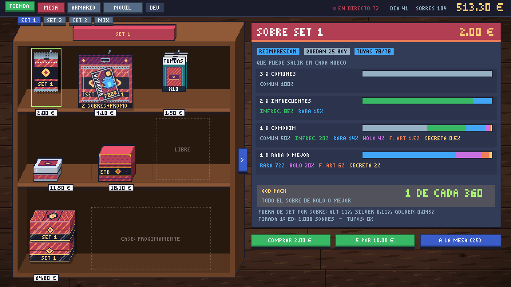
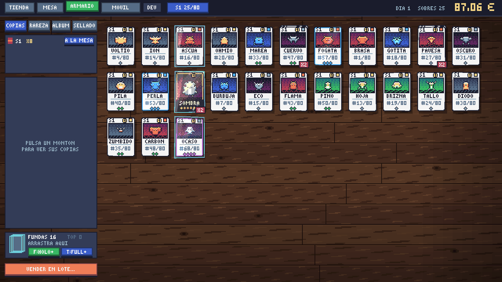
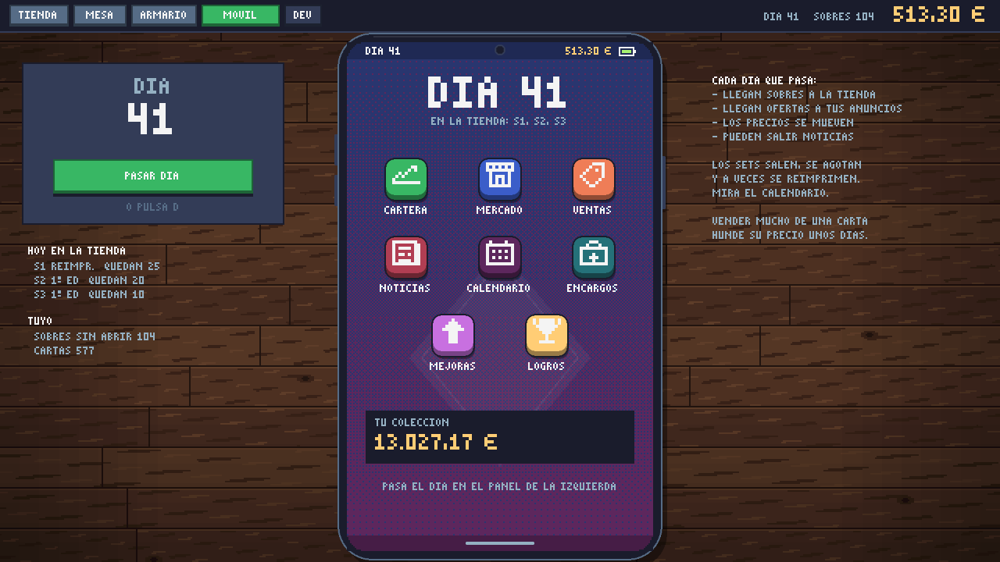

# One Last Pack


Simulador de abrir sobres de un TCG propio. Abres sobres en tu cuarto, completas la colección, vendes en un mercado que sube y se hunde y, mientras tanto, haces directos con un chat que reacciona a lo que te sale.

Hecho en Lua con LÖVE, a 640x360 en pixel art. Funciona en PC y en Android. El objetivo es sacar una demo en Steam.



## Qué hay

- 8 sets con su elemento (de 50 a 80 cartas cada uno), seis rarezas, chase, god packs y piedad. Las cartas se generan por código: un bicho, su fondo y su acabado según la rareza.
- Apertura con suspense: mantener para rasgar y revelar de peor a mejor.
- Mesa con física de péndulo al arrastrar sobres, cajas, fundas y cartas.
- Directos: espectadores, seguidores, propinas, peticiones del chat (en español o inglés) y directos de venta de sobres, en los que puedes rechazar compras.
- Mercado que se mueve por días, con memoria: rachas, noticias, burbujas, crashes, 1ª edición con precio propio, reimpresiones y vintage.
- Móvil del juego con sus apps: cartera, mercado con vendedores de segunda mano, ventas, noticias, calendario, encargos, mejoras y logros.
- Cajas selladas, fundas y top loaders, colección sellada, premios por completar sets y cartas buscadas.
- Desbloqueos por hitos y un tutorial con una mascota.

| | |
|---|---|
|  |  |
|  |  |

## Cómo jugarlo

Las APK y los zip de Windows de cada versión están en [Releases](../../releases).

Desde el código:

1. Instala [LÖVE 11.5](https://love2d.org).
2. Arrastra la carpeta del proyecto encima de `love.exe`, o en terminal: `love one-last-pack`.

La partida se guarda sola en `partida.lua` (en Windows, `%APPDATA%/LOVE/one-last-pack/`).

## Controles

En PC se juega con ratón; en Android, igual pero tocando.

- TAB: cambiar entre tienda, mesa, armario y móvil.
- Mesa: arrastra un sobre de la caja al tapete y mantén pulsado para rasgarlo. Click o espacio revela la siguiente carta.
- Espacio en la mesa: recoger y abrir el siguiente sobre.
- Fundas y tops: se arrastran de la caja a una carta cuando el sobre ya está abierto. Un top sin funda también se puede poner, pero la carta se puede rayar.
- Velocidad de apertura: con la mejora MANOS RÁPIDAS, el botón >> de arriba a la izquierda del tapete la cambia (también en plena apertura).
- Guardar un sobre sin abrir: botón GUARDAR, arrastrarlo a la caja, ESC o clic derecho.
- Cajas: se arrastran al tapete para abrirlas. Tocando una cerrada sale SACAR SOBRES.
- Blísters: cuelgan de la barra de abajo de la mesa; se tocan para rasgarlos.
- Armario SELLADO: arrastra lo de un hueco a otro para colocarlo a tu manera (si el otro está lleno, se cambian).
- Directo: en la mesa, ponle nombre al canal y dale a EMPEZAR DIRECTO. Ir al móvil o pasar el día lo corta.
- Twitch: en OPCIONES (o CONECTAR TWITCH en el directo) escribe tu canal y dale a CONECTAR; tu chat sale en el del juego. En la venta de sobres, `!comprar` en tu chat es una compra de verdad.
- D: pasar el día. Rueda o arrastrar: scroll en el móvil. Retroceso: atrás en el móvil.
- F11 o Alt+Enter: pantalla completa. ESC: volver al menú.
- F1: herramientas de desarrollador.

## Cómo está organizado

```
main.lua        escenas, entradas, barra de arriba y riel lateral
conf.lua        ventana y versión de LÖVE
datos/          tablas sin lógica: cartas, sets, sobres, mercado, mejoras, chat...
src/            lógica y pantallas
sprites/        logo y mascota
musica/         tema de la intro
herramientas/   pruebas automáticas, bots de economía, simulador de mercado y APK
```

Casi todo lo que se ajusta está en `datos/`, separado del código:

- `datos/cartas.lua`: todas las cartas, una línea por carta. Las de fuera de set (ALT, SILVER y GOLDEN) salen solas de las marcadas.
- `datos/variantes.lua`: las cartas de fuera de set: nombre, color, brillo y suspense.
- `datos/sets.lua`: los sets y lo que vale cada rareza en cada uno.
- `datos/sobres.lua`: precio, huecos y probabilidades de cada sobre, god pack, piedad, cajas y con qué se empieza.
- `datos/productos.lua`: los productos sellados (blíster, tin, ETB, caja): qué llevan, precio, cuántos llegan al día y cuántos caben en un hueco.
- `datos/calendario.lua`: cada cuánto sale un set, cuánto dura su tirada y sus reimpresiones.
- `datos/mercado.lua`: cómo se mueven los precios (rachas, noticias, vintage, burbujas, comisión, compradores).
- `datos/directo.lua` y `datos/chat.lua`: espectadores, propinas, venta en directo y las frases del chat.
- `datos/mejoras.lua`, `datos/encargos.lua`, `datos/vendedores.lua`, `datos/logros.lua`, `datos/premios.lua`.
- `datos/desbloqueos.lua` y `datos/guia.lua`: qué se desbloquea y cuándo, y los textos de la mascota.
- `datos/paleta.lua` (Sweetie 16), `datos/elementos.lua` y `datos/firma.lua`.

En `src/`:

- `mesa.lua`, `apertura.lua`, `caja.lua`, `productos.lua` y `encima.lua`: la mesa, abrir sobres, las cajas, el dibujo de los demás productos sellados y lo que se pinta a resolución real (lo que se arrastra).
- `muebles.lua`: estanterías, baldas, ganchos, blísteres y álbumes en 3D, con la misma perspectiva que la caja (tienda, mesa y armario).
- `directo.lua` y `emojis.lua`: el directo y su chat.
- `twitch.lua`: el chat de Twitch por IRC (solo lectura, en un hilo aparte).
- `movil.lua`, `grafica.lua` y `vendedores.lua`: el móvil con todas sus apps.
- `tienda.lua`, `armario.lua`, `menu.lua`, `opciones.lua`, `reporte.lua` y `errores.lua`: el resto de pantallas.
- `mercado.lua` y `calendario.lua`: el mercado y las fechas de cada set.
- `carta.lua`, `bicho.lua` y `generador.lua`: cómo se pinta una carta, el generador de bichos y el sorteo de cada sobre.
- `partida.lua`: el guardado, copia a copia.
- `desbloqueos.lua`, `guia.lua`, `tutorial.lua` y `logros.lua`: el progreso.
- `ui.lua`, `fuentes.lua` (fuente propia de 3x5), `fx.lua`, `sonido.lua`, `nav.lua`, `transicion.lua` y `dev.lua`.

Si una carta lleva `sprite = "algo.png"` en `datos/cartas.lua`, se usa ese dibujo de `sprites/` en vez del bicho generado.

## Pruebas y economía

En `herramientas/` hay un arnés que juega solo con el juego en una pantalla virtual y saca capturas, bots que juegan 240 días con distintas estrategias para ver si la economía aguanta y un simulador del mercado de 600 días. Cómo se usan, en [herramientas/LEEME.md](herramientas/LEEME.md).

## Versiones

Lo que cambia en cada versión está en [CHANGELOG.md](CHANGELOG.md). Cada versión tiene su etiqueta (`v0.9.2`) y su build en Releases.

## Licencia

Todos los derechos reservados. Es un juego comercial y el repo es solo para consulta.
